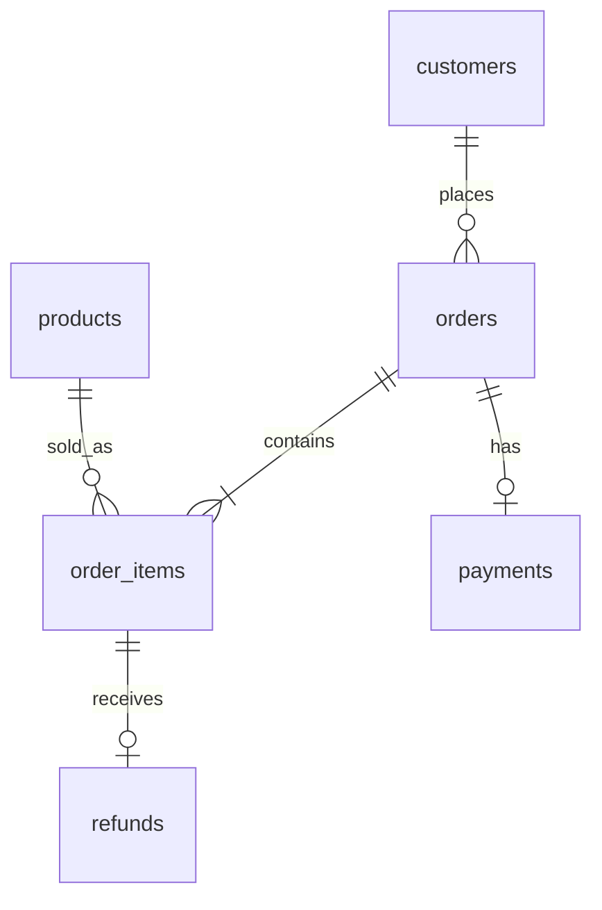

# Data model and metric contract

The generator ensures each order has items and one payment record. Foreign keys alone do not enforce that every parent has a child.

| Table | Row grain | Key facts |
|---|---|---|
| customers | Customer | Synthetic ID, signup date, city |
| products | Product | Name, category, current price |
| orders | Order | Customer, date, channel, status |
| order_items | Product within order | Quantity, price at purchase, line discount |
| payments | One payment record per order | Captured/failed, amount |
| refunds | One refund event per item | Date, amount, reason |

All currency columns are integer paise (100 paise = INR 1). A line discount is the total discount on that line, not the discount per unit. Historical unit prices are copied to order_items so catalogue changes cannot rewrite past sales.

## Reporting definitions

- Snapshot: end of 2025-12-31. All generated refunds occur by that date.
- Sales: quantity × historical unit price − line discount, on completed orders.
- Net sales: sales minus refunds known at the snapshot. Neither profit nor lifetime value.
- Refund attribution: back to the original order month. This is an order-cohort report, not monthly cash movement. A cash report must group payments and refunds by their event dates; payment event dates are not modeled here.
- Net AOV: net sales / completed orders, including orders with refunds.
- Payment comparison: captured amount versus discounted order value before refunds; refunds are separate outgoing events.
- Repeat rate: customers with at least two completed orders / customers with at least one.
- Cohort: month of first completed purchase. Retention is distinct purchasing customers in a later month / original cohort size. A customer can return after skipping a month. Future, unobservable months are omitted.
- RFM: recency in days as of 2026-01-01, completed order count, net spend. Higher quintile scores are better. NTILE splits ties deterministically by customer ID; equal behavior may therefore receive adjacent scores. Segment thresholds are illustrative rules.

## Avoiding join fanout

A payment is at order grain; items are at line grain. Joining payments to every item and summing payment amounts multiplies cash by basket size. Q08 aggregates items first. The order_financials view likewise has exactly one row per completed order. The refunds join is safe only because item_id is unique in refunds.

## Deliberate limits and next steps

One currency, one payment record per order, at most one refund per line, two order statuses, and a fixed snapshot simplify the model. There is no tax, shipping, inventory, marketing cost, or cost of goods, so do not call net sales profit. Refund amounts/date ordering and status consistency are verified in tests rather than fully enforced with database triggers. Updates from arbitrary writers could violate these cross-table rules.

For a production extension: model multiple payment attempts and partial captures, multiple refunds with an aggregate cap, timestamped state transitions, consent-aware customer data, idempotent ingestion, migrations, access control and a reporting snapshot parameter. Pre-aggregate each event table separately before joining.

## Index discussion

Open results/query_plan.txt. The bounded date query can search idx_orders_date. Compare it manually with `EXPLAIN QUERY PLAN SELECT * FROM orders WHERE substr(order_date,1,7)='2025-11';` which generally scans instead. Do not claim a speedup without measuring identical workloads. At 5,000 orders, timings are too small for credible scale claims. Extra indexes increase write and storage costs.
